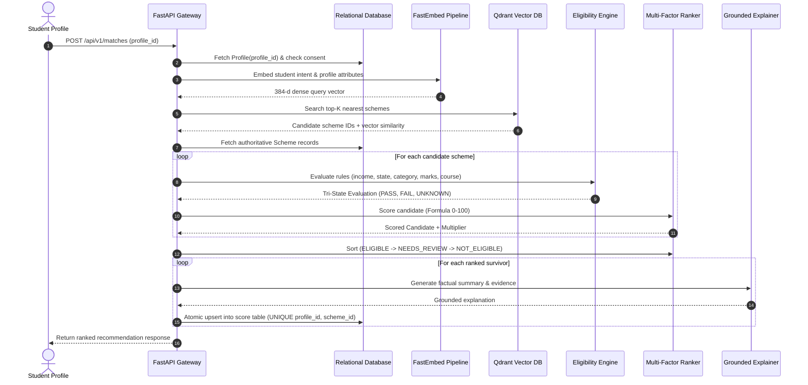

# ScholarPilot AI/ML Architecture

## 1. System Overview
The AI/ML service functions as an autonomous decision support engine within ScholarPilot. It operates downstream of TinyFish/Go portal extractors and upstream of the Spring Boot tracker and React user interface.

```
+-------------------------------------------------------------------------+
|                              ScholarPilot                               |
+-------------------------------------------------------------------------+
|                                                                         |
|  [React Frontend] <---> [Spring Boot Backend] <---> [PostgreSQL DB]     |
|          ^                         ^                        ^           |
|          |                         | (REST API)             | (Persist) |
|          v                         v                        v           |
|  +-------------------------------------------------------------------+  |
|  |                     AI/ML Recommendation Engine                   |  |
|  |                                                                   |  |
|  |  +-------------------+   +--------------------+   +-------------+ |  |
|  |  | FastEmbed (Local) |   | Qdrant Vector DB   |   | SQL Engine  | |  |
|  |  | ONNX BGE-Small    |-->| Collection         |---| Persistence | |  |
|  |  +-------------------+   | 'scholarships_v1'  |   | Score Table | |  |
|  |                          +--------------------+   +-------------+ |  |
|  |                                    |                              |  |
|  |                                    v                              |  |
|  |  +--------------------------------------------------------------+ |  |
|  |  |          Deterministic Eligibility Engine (Non-LLM)          | |  |
|  |  |               Tri-State: PASS | FAIL | UNKNOWN               | |  |
|  |  +--------------------------------------------------------------+ |  |
|  |                                    |                              |  |
|  |                                    v                              |  |
|  |  +--------------------------------------------------------------+ |  |
|  |  |                 Multi-Factor Transparent Ranker              | |  |
|  |  |    Final Score = (0.35*Sem + 0.25*Cov + 0.2*Awd + 0.2*Urg)*M | |  |
|  |  +--------------------------------------------------------------+ |  |
|  |                                    |                              |  |
|  |                                    v                              |  |
|  |  +--------------------------------------------------------------+ |  |
|  |  |          Grounded LLM Explainer + Deterministic Fallback     | |  |
|  |  +--------------------------------------------------------------+ |  |
|  +-------------------------------------------------------------------+  |
+-------------------------------------------------------------------------+
```

---

## 2. Recommendation Flow Sequence



---

## 3. Key Design Principles

1. **Semantic Similarity != Eligibility:** Cosine distance is used only as an exploratory retrieval filter. A 99% vector similarity will **never** override a failed mandatory eligibility rule.
2. **Deterministic Sovereignty:** The rule engine is written in pure Python. The LLM is never permitted to evaluate eligibility or alter scores.
3. **Graceful Degradation:** When the LLM is absent or times out, the deterministic explainer seamlessly synthesizes natural language copy from evaluated rule evidence.
4. **Zero Paid Resources:** Uses local CPU ONNX embeddings (`BAAI/bge-small-en-v1.5`) and free local/cloud Qdrant.
